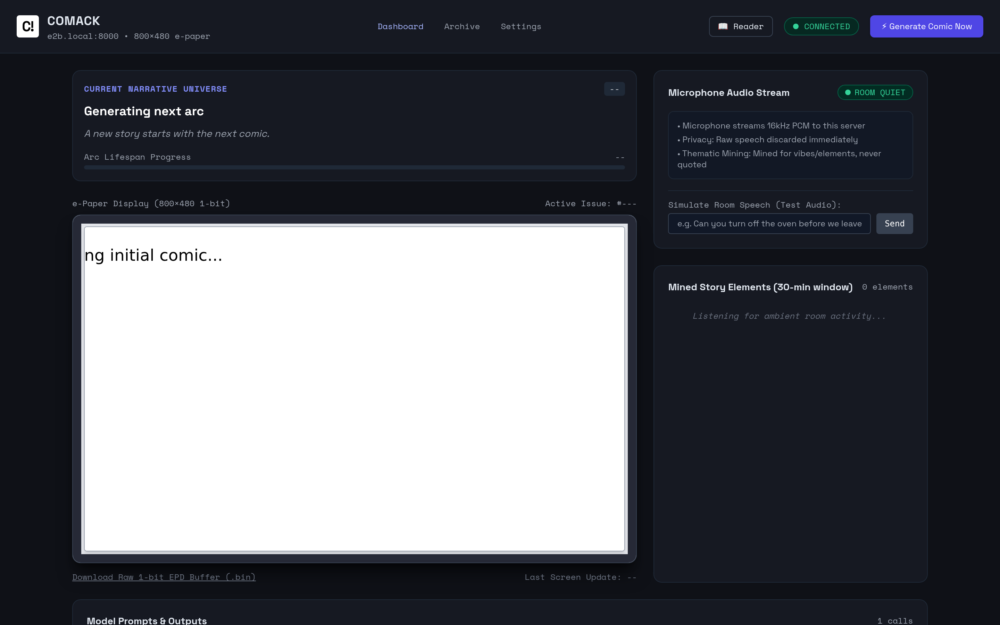
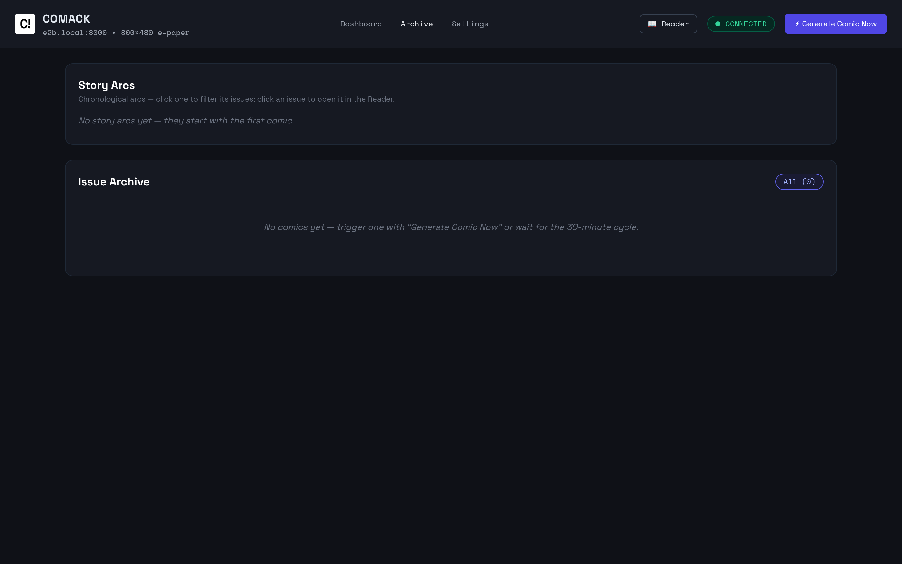
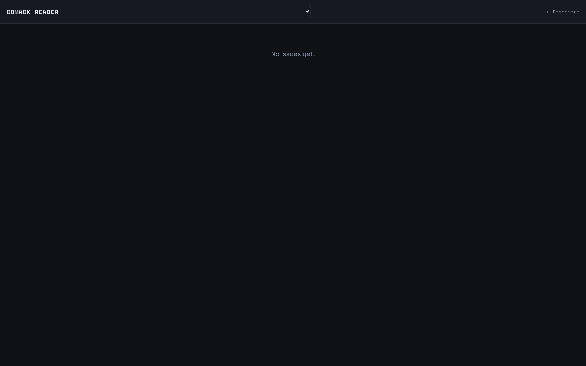
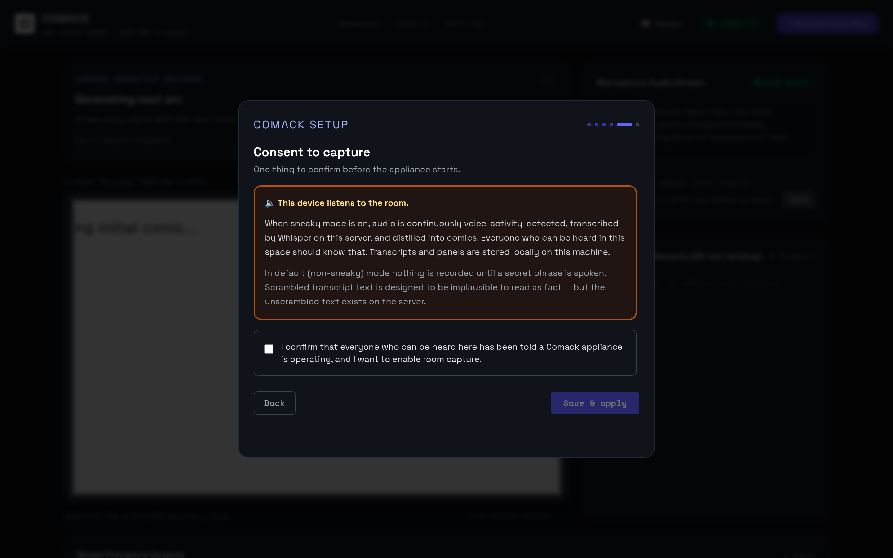
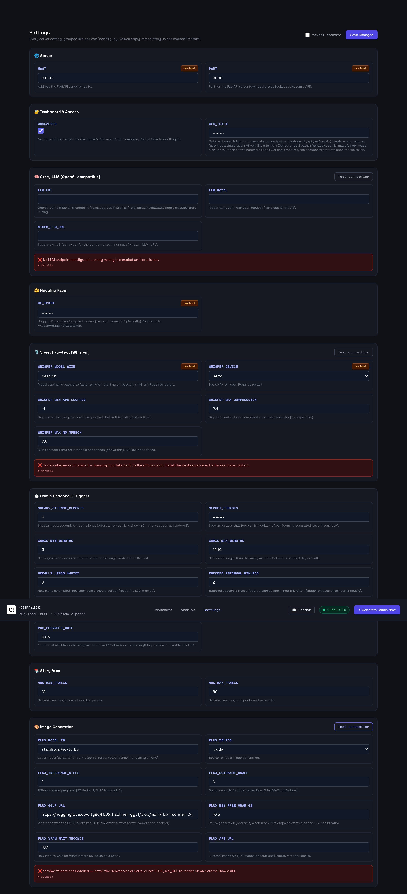

# Comack

[](https://github.com/locriani/comack/actions/workflows/server.yml)

**Comack is a privacy-first appliance that turns room conversation into an
ever-evolving surreal comic strip.** A Seeed **reTerminal E1001** (ESP32-S3,
7.5″ 800×480 e-paper, PDM microphone) sits in your room and streams audio to a
server you own. The server transcribes what it hears, filters it through a
part-of-speech word-scramble that makes attribution impossible, and feeds the
scrambled residue to an LLM that mines story material. Stories grow into
multi-panel narrative arcs, get rendered as comics, and appear on the e-paper
on the wall. You never see raw transcripts — your guests' words become dream
material before anything is stored.

| Dashboard | Archive | Reader |
|---|---|---|
| [](docs/images/dashboard.png) | [](docs/images/archive.png) | [](docs/images/reader.png) |

First run leads with a setup wizard — including an explicit capture-consent
gate — and a settings page whose connection probes report honestly what is
and isn't reachable:

| Onboarding consent gate | Settings with probes |
|---|---|
| [](docs/images/onboarding-consent.png) | [](docs/images/settings-probes.png) |

> **No hardware? You don't need the device to try it.** The server, dashboard
> and a desktop simulator all run on an ordinary laptop — see
> [the no-hardware quickstart](docs/installation.md#the-desktop-simulator).

## Quickstart

**The appliance (Docker):**

```sh
git clone https://github.com/locriani/comack && cd comack
docker compose up -d --build
# Dashboard: http://localhost:8000/
```

The container includes the AI dependencies; first comic downloads the
configured image model. Point the LLM at any OpenAI-compatible endpoint
(onboarding in the UI, or the compose file) — without it the pipeline stops
before mining and everything else still runs. Deployment details:
[self-hosting](docs/self-hosting.md).

**No hardware (light server + desktop simulator):**

```sh
pip install -e .            # light core — no torch/diffusers needed
uvicorn server.main:app --port 8000
# second terminal:
python simulator/reterminal_sim.py --host localhost --port 8000
```

Both paths, first run, and the onboarding walkthrough:
[docs/installation.md](docs/installation.md).

## How it works

```
room audio → voice activity detection → Whisper transcription (local)
          → POS word-scramble  ← the only text that is stored or sent onward
          → LLM story mining → narrative arcs (12–60 panels)
          → comic render (local diffusers or external API)
          → e-paper on the wall + web dashboard/reader
```

The full pipeline, with each stage's guarantees:
[docs/installation.md](docs/installation.md#1-install-the-server) ·
device firmware: [firmware/README.md](firmware/README.md).

## Documentation

| | |
|---|---|
| [docs/installation.md](docs/installation.md) | Server setup, first run, onboarding walkthrough, desktop simulator, pointer to firmware flashing |
| [docs/configuration-reference.md](docs/configuration-reference.md) | Every server setting: meaning, type, default, bounds, hot-apply vs restart |
| [docs/self-hosting.md](docs/self-hosting.md) | Docker Compose, systemd, the deploy script, and `WEB_TOKEN` access control |
| [docs/troubleshooting.md](docs/troubleshooting.md) | Port conflicts, model downloads, VRAM, probe failures, device not appearing |
| [CONTRIBUTING.md](CONTRIBUTING.md) | Dev setup, test commands, PR expectations |

| Directory | What lives there |
|---|---|
| `firmware/` | Rust device firmware: `no_std` core, desktop simulator, ESP32-S3 binary, vendored C components ([details](firmware/README.md)) |
| `server/` | Python FastAPI server: VAD, transcription, scramble, mining, narrative, rendering, storage, web UI |
| `simulator/` | Python desktop stand-in for the device hardware (`reterminal_sim.py`) |
| `tests/` | Python test suite (runs without the heavy AI dependencies) |

## Privacy & Ethics (summary)

Comack is built to listen to a room, and that demands care:

- **Designed for your own space** — a device you own, streaming to a server
  you own, storing on a disk you own. No cloud, no accounts. Run it where
  everyone present can see the e-paper, and tell your guests what it is.
- **Local-first** — audio, transcripts, story state and comics live in `data/`
  on the machine running the server. Nothing is replicated or phoned home.
- **The POS scramble is built-in deniability** — before a sentence is stored
  or sent anywhere, most content words are swapped for random
  same-part-of-speech stand-ins. Sentence structure survives; meaning and
  attribution do not. What the LLM mines, and what ends up on disk, is that
  scrambled text — not what was said.
- **Only three doors out, all optional, all pointed at endpoints you
  configure**: your LLM endpoint (`LLM_URL` — self-host it and text never
  leaves your network), an external image API if you configure one
  (`FLUX_API_URL`), and one-time model downloads from Hugging Face. Your
  audio and raw text are not part of any of them.
- **Silence is discarded** — voice activity detection runs first; noise and
  silence are dropped before transcription, not merely ignored. The onboarding
  wizard makes the capture-consent acknowledgement explicit and unavoidable.

This is an art project with a wiretap's surface area, handled accordingly.

## Development

See [CONTRIBUTING.md](CONTRIBUTING.md) for dev setup, test commands and PR
expectations. Where the project is headed — and what landed recently — is in
[ROADMAP.md](ROADMAP.md).

## License

MIT — see [LICENSE](LICENSE) and [NOTICE](NOTICE) (which covers the
vendored firmware components: MicroLink, wireguard_lwip, cJSON).
