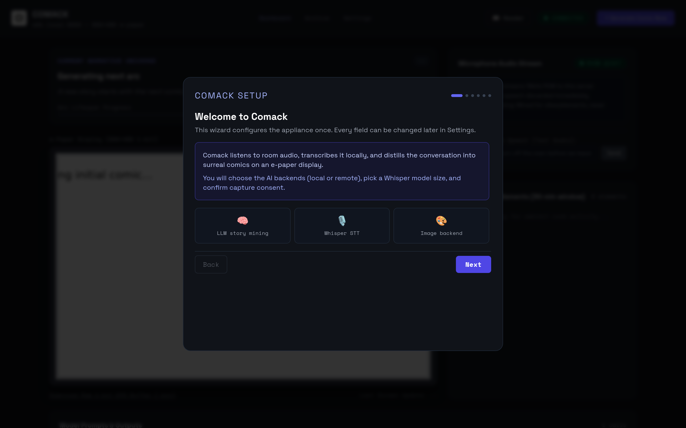
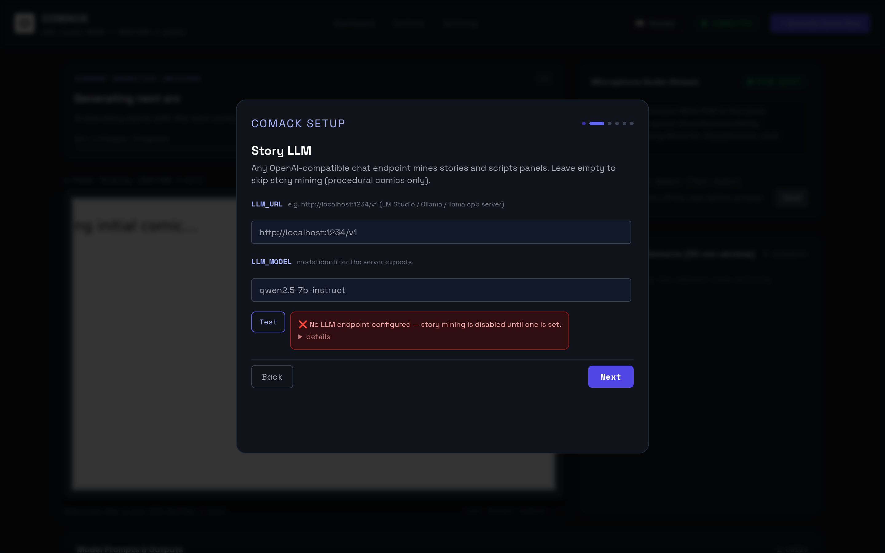
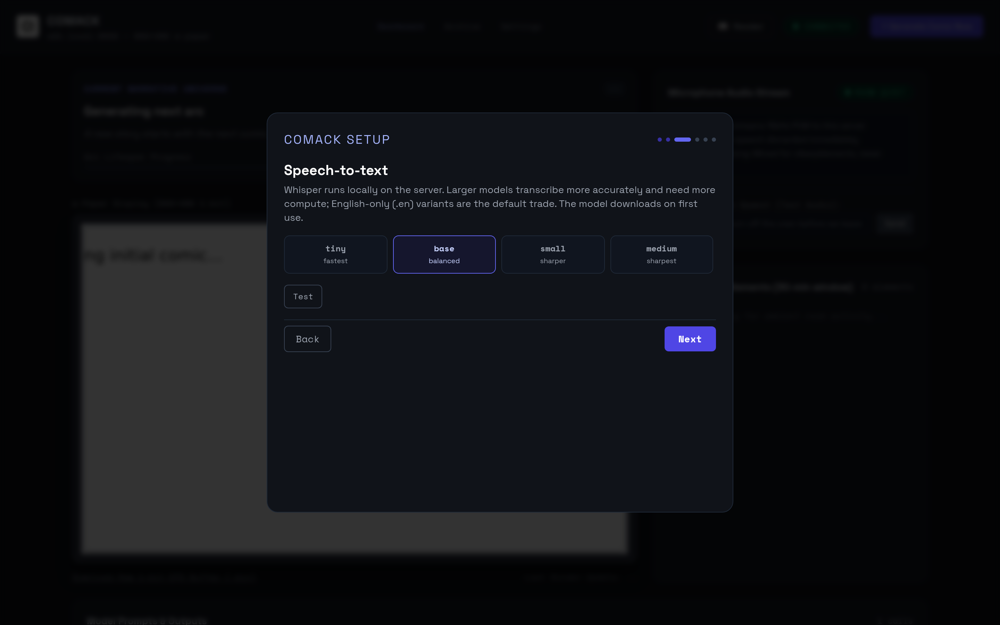
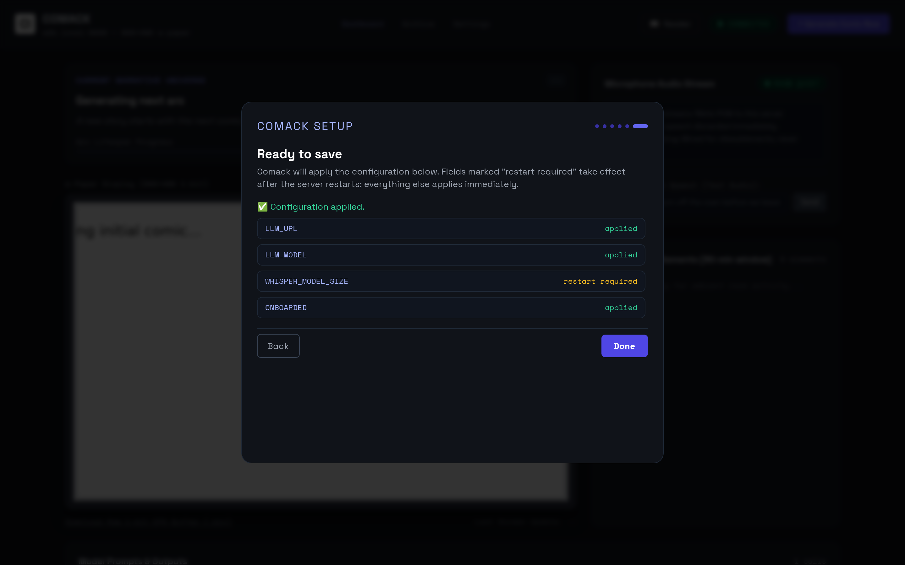

# Installation

Get the Comack server running — with or without the e-paper device. Everything
on this page was verified by executing it on a clean checkout (Python 3.13,
Linux x86-64); where your platform may differ, the text says so. See the
[verification notes](#verification-notes) at the bottom for exactly what ran.

**Three paths, in increasing commitment:**

| Path | Needs | Gets you |
|---|---|---|
| [Light server + dashboard](#1-install-the-server) | Python 3.11+ | The full web experience: onboarding wizard, settings, archive, reader — honestly reporting that transcription/rendering backends are not installed yet |
| [Desktop simulator](#the-desktop-simulator) | The light server | A window that streams synthetic room audio and displays whatever the e-paper would show |
| [The real device](#the-real-device) | reTerminal E1001 + toolchain | The actual wall appliance |

You do not need a GPU, an LLM, or any heavy AI dependency to complete any of
the no-hardware paths. The dashboard works, and its connection probes will
tell you plainly what is missing — that is the intended first-run experience,
not a defect.

## 1. Install the server

Prerequisites: **Python 3.11+** and **git**. (Verified on Python 3.13; the
project declares `>=3.11`.)

```sh
git clone https://github.com/locriani/comack && cd comack
python3 -m venv .venv && source .venv/bin/activate
pip install -e .            # light core: server, web UI, tests — no torch/diffusers
```

Or let the repo's script do all of it — including the `.env` seeding and the
systemd unit rendering covered over on
[self-hosting](self-hosting.md#systemd-venv--the-local-gpu-profile):
`./scripts/setup.sh` is idempotent (every step skips itself when already
done); `--ai` adds [the heavy stack](#4-add-the-heavy-ai-stack-optional).

The light core installs FastAPI, uvicorn, Pillow, NumPy, NLTK, httpx and
pydantic-settings — everything the API, privacy scrambler, compositor and web
UI need. It deliberately excludes the heavy AI wheels (`torch`, `diffusers`,
`faster-whisper`); [step 4](#4-add-the-heavy-ai-stack-optional) covers adding
them, and every import they are needed for degrades gracefully without them.

To also run the test suite you need the `dev` extra: `pip install -e '.[dev]'`.
The suite runs without the heavy dependencies:
`pytest -q` → **99 passed, 23 subtests passed** (verified on this exact install).

## 2. First run

```sh
uvicorn server.main:app --port 8000
# or, from the repo root: ./run_server.sh  (binds 0.0.0.0 + --reload, dev-oriented)
```

Open **http://localhost:8000/** — the first run leads with the setup wizard,
described below. What the server log shows on a light install (verified
output, lightly trimmed):

```
INFO:     Started server process [2726]
INFO:     Waiting for application startup.
comack.main: No existing comic found. Generating initial comic Issue #001...
comack.main: Executing comic generation cycle...
comack.main: Gathered 0 dialogue snippets for this cycle.
comack.llm: LLM_URL is not set; skipping the LLM call
comack.main: Error executing immediate comic cycle: the LLM did not invent a new arc; the next cycle retries
comack.main: Comic scheduler started: 5.0-1440.0 min between comics.
INFO:     Application startup complete.
```

Read that honestly: the server boots, tries to generate a first comic, and —
because no LLM is configured on a light install — reports that the cycle
failed and will retry. The dashboard, wizard, settings, archive and reader all
work; comics themselves need [backends](#4-add-the-heavy-ai-stack-optional).
The same warning appears (once, per process) when audio arrives and
`faster-whisper` is absent:

```
comack.transcriber: Could not load faster-whisper: No module named 'faster_whisper'.
Falling back to conversational mock/fallback transcriber.
```

State lives in `data/` (SQLite database plus comic files, created at startup).
A fresh database starts empty: the dashboard, archive and reader show their
empty states ("No comics yet — trigger one with Generate Comic Now or wait for
the 30-minute cycle") until the first comic completes.

## 3. First-run onboarding

The wizard runs once — it completes by setting `ONBOARDED=true` (persisted to
`.env`; set `ONBOARDED=false` to see it again, or from Settings → flip the
checkbox). Six steps; the screenshots are captured from the real dashboard on
a light install.

**Welcome.** What the appliance does and what you will configure.



**Story LLM.** Any OpenAI-compatible chat endpoint (llama.cpp, vLLM, Ollama, hosted APIs…). Leave it empty to skip story mining. Endpoints that authenticate need an **API key** on this step (`LLM_API_KEY`). The **Test** button runs the same read-only probe the settings page uses — on a fresh install it says exactly what is true:



**Speech-to-text.** Pick a Whisper model size (`tiny.en` … `medium.en`);
larger is more accurate and slower. Nothing downloads at this point — the
model downloads on first use once `faster-whisper` is installed (sizes in
[troubleshooting](troubleshooting.md#whisper-model-downloads)).



**Image generation.** Pick how panel art renders: **Local GPU**, **External
Image API**, or **CPU only**. Each card prefills the fields that the matching
[preset file](../presets/) sets (`local-gpu`, `external-api`, `cpu-only`).


**Consent to capture.** Deliberately unmistakable: this appliance listens to a
room. The step explains what is voice-activity-detected, transcribed, and
stored — and the checkbox gates the button. No consent, no save.


**Finish.** Saving applies the configuration and shows a per-field result:
green `applied` (live immediately) or amber `restart required` (takes effect
on the next server restart). On a fresh install `WHISPER_MODEL_SIZE` shows
`restart required` — the transcription model is bound when the process starts.



After onboarding you land on the dashboard:


## 4. Add the heavy AI stack (optional)

The `local-inference` extra installs local transcription (faster-whisper) and
local rendering (torch + diffusers, GGUF FLUX):

```sh
pip install -e '.[local-inference]'
```

This is several gigabytes of wheels and, on first use, model downloads
(Whisper weights, SD-Turbo or FLUX.1-schnell). If you would rather not, point
`LLM_URL` / `LLM_API_KEY` and `FLUX_API_URL` / `FLUX_API_KEY` at external
OpenAI-compatible endpoints instead — see
[configuration reference](configuration-reference.md) and
[presets](../presets/). The settings page's **Test connection** buttons report
which backends are usable right now:


## The desktop simulator

`simulator/reterminal_sim.py` emulates the reTerminal: it streams synthetic
16 kHz PCM audio to the server over `/ws/audio` (cycles of 5 s speech-shaped
tone, 25 s room noise), listens on `/ws/events` for comic-refresh events, and
puts the device's three front buttons on the keyboard.

```sh
# terminal 1 — the server (light core is fine)
uvicorn server.main:app --port 8000

# terminal 2 — the simulator, with a display (tkinter)
python simulator/reterminal_sim.py --host localhost --port 8000
```

What appears (verified under a virtual display): a window titled
*reTerminal E1001 Simulator (800x480 e-Paper)* — device bezel, the 800×480
panel showing the current comic, and a status line. With no comic yet the
panel is blank, exactly like the real e-paper before a first render; when a
`SNEAKY_COMIC_REFRESH` event arrives the window flashes black then white —
the authentic e-paper refresh dance — before showing the new issue.


The front buttons live on the keyboard (the real device has three physical
buttons — see [the firmware README](../firmware/README.md)):

- `←` / `→` (or `b` / `f`) page to the nearest older/newer revealed issue —
  the same walk the device's Navigator does: deleted gaps are stepped past,
  the walk never goes beyond the latest revealed issue, and each step fetches
  the issue's `/api/comics/{n}.png`;
- `g` (or space) is the green trigger: it reports the press to
  `/api/device/buttons` (the dashboard's pressed-button chip), fires the same
  `/api/trigger` call the device makes, and refetches the current comic right
  away. While a new comic is still generating, the refresh event flashes it
  in the moment the server reveals it.

Every press — forward, back, and trigger — is reported to the server, the way
the firmware reports its presses.

Two notes from verification:

- The window is sized 840x620 to fit the device bezel, the status line, and
  the key-bindings footer. (On a real desktop you also get a title bar.)
- On a machine without a display, run `--headless` for the audio/event
  streaming only:

```sh
python simulator/reterminal_sim.py --host localhost --port 8000 --headless
```

The server log confirms a working stream either way (verified):

```
comack.main: reTerminal E1001 audio streamer connected.
```

## The real device

Building and flashing the ESP32-S3 firmware (Xtensa toolchain, ESP-IDF,
Tailscale integration, button wiring) is documented in
[firmware/README.md](../firmware/README.md) — that document is the source of
truth and is not duplicated here. The device needs nothing from this page
except a running server reachable on your network.

## Verification notes

What this page claims from execution (clean checkout, Python 3.13.14, Linux
sandbox, no GPU, no display):

- `pip install -e '.[dev]'` (the light core plus pytest/ruff) and
  `pytest -q` → 99 passed + 23 subtests passed.
- `scripts/setup.sh` end-to-end on a clean checkout (light core): the second
  run verified as a no-op, an edited `.env` left untouched, and the rendered
  `comack.service.rendered` free of placeholders. `bash -n` and shellcheck
  0.10.0 clean.
- Server boot, startup log lines, and the honest first-comic failure shown
  above.
- All three connection probes and their "not installed / not configured"
  responses, via the UI and `POST /api/config/test/{llm,image,whisper}`.
- The full onboarding walkthrough (with consent gate) and every screenshot
  above, in headless Chrome at 1440×900.
- The simulator: headless streaming against the running server (server-side
  log evidence), and the GUI window rendered under a virtual display for the
  screenshot.
- `docker compose config` — see [self-hosting](self-hosting.md) for what that
  did and did not cover; the container build itself was **not** executed here.

Not executed for this page: the heavy `local-inference` install (wheels +
GPU), real transcription/rendering, and device flashing. Those sections
describe the documented behavior of their components, not a fresh run — the
[honest no-hardware experience](#2-first-run) is what was verified.
